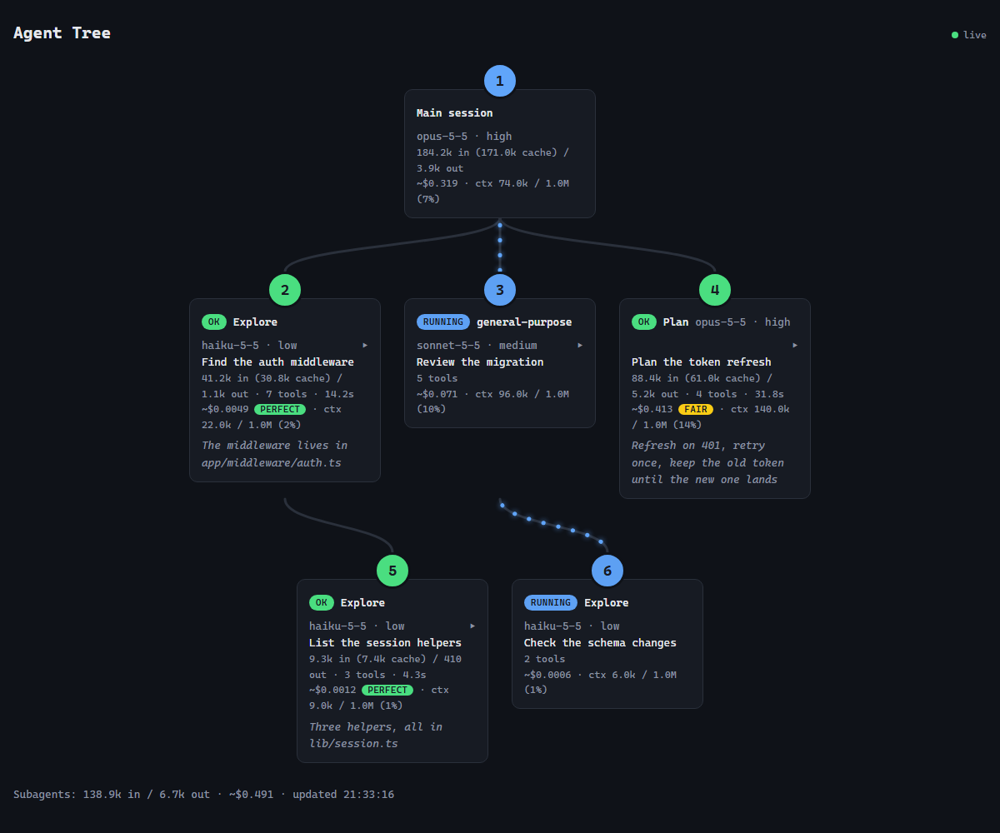

# agent-tree

A Claude Code mod that opens an **Agents** pane beside the chat with a live tree of the main session (the orchestrator) and every subagent it spawns: model, effort, tokens (input, cache, output), tool calls, duration and the first line of each answer.

It costs no model tokens: the hooks run inside the app and the pane is drawn by the interface, so nothing is added to the prompt.



The same tree as a web page (sample data). Each card shows the agent's estimated cost, its rating once it ends and how full its context is; the dots on a wire run from parent to child while that agent is working.

```
Main session · opus-5-5 · high
  48.2k in (41.0k cache) / 1.3k out
├─ [ok] Explore · haiku-5-5 · low
│    Find the auth middleware · 12.4k in (9.8k cache) / 0.6k out · 7 tools · 14.2s
│    The middleware lives in app/middleware/auth.ts and ...
└─ [running] general-purpose · sonnet-5-5 · medium
     Review the migration · 3 tools
Subagents: 12.4k in / 0.6k out
```

## Install and use in Claude Code Desktop

1. Clone the repository:

   ```bash
   git clone https://github.com/pedrowillen/claude-agent-tree.git C:\projects\claude-agent-tree
   ```

2. Point Claude Code at the folder with a **user** environment variable. On Windows (PowerShell):

   ```powershell
   [Environment]::SetEnvironmentVariable('CLAUDE_CODE_PLUGIN_DIRS', 'C:\projects\claude-agent-tree', 'User')
   ```

   On macOS/Linux, export `CLAUDE_CODE_PLUGIN_DIRS=/path/to/claude-agent-tree` in your shell profile (and make sure the desktop app inherits it).

3. Quit the Claude desktop app completely and open it again, so new sessions see the variable.

4. Start a session in the **Code** tab. A question asks how you want to see the agents: the **Agents** pane, the **web page**, the **Edge window** (Windows only), or any mix. Run `/agent-tree` to choose again.

From the terminal CLI, you can load it for a single session instead:

```bash
claude --plugin-dir C:\projects\claude-agent-tree
```

### Reading the pane

- **Main session**: model and effort of the last request, plus total tokens (`in` includes cache; the cached part is shown in parentheses).
- **One node per subagent**: `[running]`, `[ok]`, `[error]` or `[aborted]`, the subagent type, model and effort, the task description, tokens, tool calls and duration, then the first line of its answer (up to 200 characters).
- **Subagents** footer: tokens summed over the subagents shown.
- Subagents from the previous prompt are cleared when the next prompt spawns its first subagent; ones still running are kept. At most 20 subagents are shown.
- Below 70 columns each detail goes on its own line, and no line ever wraps: lines longer than the pane are cut with `…`.

### The web page

The same tree is served as a live web page at **http://127.0.0.1:47821/?t=&lt;key&gt;**, in a monospaced font. The key is made by the server each time it starts; the pane, the status line and the Edge window carry the full link. Agents sit on one row per level, joined by wires; the wire of an agent that is working has dots running down it, from parent to child (they stop with `prefers-reduced-motion`). The mod starts a small Node server when the session starts and stops it with the session. If the port is in use it tries the next one, up to 47830, and the pane's last line says which address it took:

```
Web: http://127.0.0.1:47822/?t=3f9a1c07d2b4e856 (47821 in use)
```

Click an agent's card to open it: the list of its tool calls (the last 50, each as `Tool: what it was given`) and its answer (up to 4000 characters). A card flashes when its agent finishes (green), fails (red) or is aborted (yellow).

Each card also shows what the agent has cost so far and how full its context is, for example `~$0.092 · ok · ctx 126.0k / 1.0M (13%)`:

- **Cost** is an estimate: each request's tokens (uncached input, cache writes, cache reads and output) priced at Anthropic's list prices per model, kept in `src/pricing.ts`. Prices change, and a model that is not in that table (an older 4.x, for one) shows no cost, and a `+` after the cost (`~$0.012+`) means a request on such a model is missing from it; a plan that is not billed per token does not pay it. The cache write is priced at the 5-minute rate. Haiku 5.5's dearer tier above 100K prompt tokens is applied per request.
- **Rating** appears when a subagent ends with its answer and its whole cost is known (a stopped or failed run, or one marked `+`, is not rated). It judges what the whole run spent, not how well it worked: `perfect` up to $0.03, `ok` up to $0.15, `fair` up to $0.60, `poor` up to $2.00 and `awful` above that. The ceilings are the `CEILINGS` list in `src/pricing.ts`. The main session shows its cost but is not rated.
- **Context** is the prompt of the agent's last request, against the context window the mod assumes for the model (shown after the slash: 1M for the current models, 200K for Haiku 4.5). A session that runs on a smaller window is fuller than the percentage says.

The terminal pane shows the same cost, rating and context, and the footer adds up the subagents' cost.

When a subagent finishes, a toast (with its cost and rating) says so; a failed one also raises a system notification. An aborted one (usually your own Esc) only gets the toast.

The server always runs; what you pick decides what is shown. **Web page** shows the address as a toast and in the status line. **Edge window** opens the page as its own window through Edge's app mode (`msedge --app=...`: no tabs, no address bar, with the Agent Tree icon in the title bar and the taskbar); it needs Edge, which comes with Windows 11, so the option is offered on Windows only. If you dismiss the question or type something else, the pane opens.

If every port is taken the line reads `Web: ports 47821-47830 in use`; without Node on the `PATH` it reads `Web: node not found`. The pane works the same either way. Each session gets its own server, so a second session takes the next free port.

The page is plain HTML, CSS and JavaScript, follows the system's light or dark theme and updates through server-sent events. The server listens on `127.0.0.1` only and refuses requests whose `Host` is not `127.0.0.1` or `localhost`. The tree holds tool commands and answers, so `/events` and `/state` also need the key (`403` without it): another program on the machine, or a website, cannot read the tree or replace it. The page and its icon hold no data and are served without it. The mod sends the tree at most about ten times a second, and always the latest one.

## How it works

A mod is a Claude Code plugin whose hooks module runs inside the app. `agent-tree` listens to the engine's events, keeps the tree in the session state (`$.state`, key `agent-tree.tree`) and redraws the pane whenever that state changes.

| Event | What the mod does |
| --- | --- |
| `session.start` | Starts the page's server (kept up until the session ends), asks how to see the agents and registers `/agent-tree` |
| `command.run` (`agent-tree`) | Asks again |
| `turn.start` | On a new user prompt, marks the tree as stale |
| `agent.spawn` | Adds a subagent node (clearing finished ones if stale) |
| `turn.step` | Records the real model and effort of each request, and from the usage that ends it adds the request's estimated cost and sets the context fill |
| `tool.call` | Counts a subagent's tool calls |
| `turn.complete` | Adds token usage; for a subagent, sets status, duration and answer summary |
| `ui.render` (`Pane`) | Draws the tree with `Box` and `Text` |

The hooks on the engine's events call `next(e)` and change nothing, so the mod only observes: it never changes, blocks or delays what the engine does. Only the mod's own `/agent-tree` command and the drawing of its pane answer for themselves.

The page's server runs through `$.process.spawn` (`node -`, its source on stdin) and lives as long as the module. It prints `BUSY <port>`, `LISTEN <port> <key>` or `FAILED <port> <code>`, which the mod reads into the state (`agent-tree.web`). After each change to the tree the mod sends it to the server with `$.http.fetch` (`POST /state`), and the server streams it to the open pages (`GET /events`).

### Structure

```
.claude-plugin/plugin.json   manifest (name, version, description, types)
hooks/hooks.json             points the engine at the hooks module
hooks/register.tsx           entry: composes the three features below
src/session.ts               session start (server, question, command) and the command that asks again
src/view.ts                  asks how to see the agents and shows the page the way the user chose
src/choice.ts                the question's options and how its answer is read
src/tree.ts                  keeps the tree of agents up to date from the loop's events
src/pane.tsx                 draws the terminal pane
src/state.ts                 shared constants and initial values
src/format.ts                number and text formatters
src/pricing.ts               list prices, context windows, cost of a request and the rating of a cost
src/web/serve.ts             runs the page's server and pushes the tree to it
src/web/window.ts            opens the page as an Edge app window
src/web/icon.ts              the page's icon (PNG, base64)
src/web/server.ts            the Node server's source and its ports
src/web/page.ts              the web page (HTML, CSS, JS) as a string
types/index.d.ts             type contract of the state (AgentNode, Tree, Web, View)
tests/pane.test.tsx          tests with the claude-code/testing kit
tsconfig.json                extends the types the engine generates
```

`.claude-plugin/types/` is generated by the engine when the mod loads and is git-ignored.

Two rules of the engine's scan shape this layout: a function that receives `$` from another file must be a `function` declaration, and an atom must be declared (`atom({ plugin, key }, initial)`) in each file that reads or writes it.

## Development

```bash
claude plugin validate .
```

```bash
claude plugin test .
```

```bash
tsc -p .
```

`tsc` needs `.claude-plugin/types/`, which exists once the mod has been loaded at least once. While the folder is loaded through `CLAUDE_CODE_PLUGIN_DIRS` or `--plugin-dir`, edits reload the mod at the end of the turn.

## License

[MIT](LICENSE)
